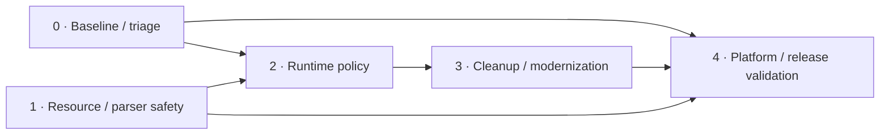

# Descent 3 source review and implementation plan

Reviewed 2026-10-30 at commit `11df7c8aa5477c09c1176b01c9ff076b03e385d3`.

## Scope and interpretation

Risk-based source review plus an actual Ubuntu LLVM clang-tidy 18.1.3 run on **16 of 365 unique translation units** (4.4% of the local database). All 16 selected invocations completed with exit code 0. Configuration: Linux x64 / Debug (first command per source). The 1,266-entry multi-config database was deduplicated by source. This denominator describes this build, not every file in the repository.

The run produced **719 distinct first-party diagnostic locations/messages**, including included headers. These are not confirmed bug counts. Deduplication uses file, line, column, check and message; dependencies/system headers are excluded. Manual reference searches also covered disabled blocks, allocation/cleanup paths, timeouts, and HTTP/audio configuration.

The initial baseline scan did not include engine fixes, game launch, sanitizer execution, cross-platform compilation, or gameplay verification. Later implementation and validation evidence is recorded per item below. Windows, editor, most gameplay/physics and plugins require further analysis. Dead-code claims are limited to permanently disabled blocks, specific dead stores and explicitly labeled removal candidates. Platform-only code is not dead code.

## Next implementation priorities

1. [C01](#c01): Expose bounded network timing policy.
2. [C02](#c02): Make HTTP connection timeout an explicit option.
3. [C03](#c03): Resolve the ignored SDL sound-buffer option.
4. [A02](#a02): Extend coverage across modules and platform configurations.

Items marked Review have implementation or triage evidence but still have an acceptance gate open; see their notes for the remaining work.

P1 = address before lower-risk cleanup; P2 = schedule next; P3 = cleanup/measurement. S/M/L are relative effort estimates, not delivery dates. Confidence is independent of priority: source-confirmed means visible control/data flow, not a runtime reproduction.

## Roadmap

| Phase | Outcome | Items | Exit gate |
| --- | --- | --- | --- |
| 0 — Baseline and triage | Pin tools, classify warnings and establish the regression gate. | T03, A01 | Each item's acceptance evidence recorded |
| 1 — Resource and parser safety | Fix ownership and bounds issues with synthetic fixtures and sanitizers. | M01, M02, M03, M04, M05, M06, B01, B04 | Each item's acceptance evidence recorded |
| 2 — Runtime policy and correctness | Expose validated options with unchanged defaults; fix file-size handling. | B02, B03, C01, C02, C03 | Each item's acceptance evidence recorded |
| 3 — Cleanup and measured modernization | Remove proven dead code; apply small reviewed tidy batches. | D01, D02, D03, T01, T02 | Each item's acceptance evidence recorded |
| 4 — Coverage and release verification | Extend platform coverage and record runtime validation. | A02 | Each item's acceptance evidence recorded |

Phase 0 triage can run alongside phase 1 safety fixes. Dependencies in the register are hard prerequisites; phases express preferred order. Split each item into reviewable patches, add regressions for changed behavior, and preserve serialized IDs, pilot files, module ABI and game assets.



## Implementation register

| ID | Priority | Category | Effort | Confidence | Status |
| --- | --- | --- | --- | --- | --- |
| [M01](#m01) | P1 | Memory and resources | L | Source-confirmed | Review |
| [M02](#m02) | P1 | Memory and resources | S | Source-confirmed | Done |
| [M03](#m03) | P1 | Memory and resources | M | Source-confirmed | Review |
| [M04](#m04) | P1 | Memory and resources | M | Source-confirmed | Done |
| [M05](#m05) | P2 | Memory and resources | S | Runtime-confirmed | Done |
| [M06](#m06) | P1 | Memory and resources | S | Runtime-confirmed | Done |
| [B01](#b01) | P1 | Correctness | M | Source-confirmed | Done |
| [B02](#b02) | P2 | Correctness | M | Source-confirmed | Review |
| [B03](#b03) | P3 | Correctness | S | Source-confirmed | Backlog |
| [B04](#b04) | P1 | Correctness | L | Runtime-confirmed | Review |
| [C01](#c01) | P2 | Configuration | M | Design opportunity | Backlog |
| [C02](#c02) | P2 | Configuration | S | Design opportunity | Backlog |
| [C03](#c03) | P2 | Configuration | M | Source-confirmed | Backlog |
| [D01](#d01) | P3 | Dead code | M | Source-confirmed | Backlog |
| [D02](#d02) | P3 | Dead code | S | Removal candidate | Backlog |
| [D03](#d03) | P3 | Dead code | S | Source-confirmed | Backlog |
| [T01](#t01) | P3 | Clang-tidy | M | Source-confirmed | Backlog |
| [T02](#t02) | P3 | Clang-tidy | M | Source-confirmed | Backlog |
| [T03](#t03) | P2 | Clang-tidy | M | Analyzer candidates | Done |
| [A01](#a01) | P2 | Clang-tidy | M | Source-confirmed | Review |
| [A02](#a02) | P2 | Clang-tidy | L | Source-confirmed | Backlog |

## M01

### Repair asynchronous DNS ownership and synchronization

Sources: [networking/networking.cpp, line 2049](../../networking/networking.cpp); [networking/networking.cpp, line 2107](../../networking/networking.cpp); [networking/networking.cpp, line 2230](../../networking/networking.cpp).

**Evidence (Source-confirmed):** On POSIX, lastaslu points to static aslu (2136), but starting another pending lookup joins then free(lastaslu) (2114). Worker and caller also access ordinary bool flags concurrently. The Windows worker frees lookup on success while lastaslu can still reference it; cancellation/replacement needs a separate lifetime audit.

**Change:** Give each request explicit ownership, join before reuse or destruction, own the hostname, synchronize result publication/cancel, and handle thread creation failure. Preserve the public polling API.

**Acceptance:** Regression: two LOOKUP calls before READ, success/error/cancel, replacement after completion, shutdown, and thread creation failure. Run ASan/LSan and a separate TSan build on POSIX; validate the Windows worker lifecycle too.

**Dependencies:** None. **Checks:** Manual review / targeted regression.

- [ ] Implemented and validated (Review)

Owner: Codex

Progress evidence / disposition: Implemented owned hostname, joined SDL worker on all lifecycle paths, atomic result publication, scoped IPv4 getaddrinfo, and shutdown-before-Winsock cleanup. Linux Debug engine build and all 44 CTest tests passed. Nine DNS tests passed 100 repetitions under ASan/UBSan/LSan and separate TSan (outside sandbox). One advisory private-enum size warning remains. Windows build/runtime and interactive multiplayer smoke checks pending. Evidence: docs/code-review/validation/M01.md.

## M02

### Close WAV input exactly once on missing-data failure

Sources: [sndlib/ddsoundload.cpp, line 414](../../sndlib/ddsoundload.cpp); [sndlib/ddsoundload.cpp, line 480](../../sndlib/ddsoundload.cpp); [cfile/cfile.cpp, line 609](../../cfile/cfile.cpp).

**Evidence (Source-confirmed):** SoundLoadWaveFile closes cfptr at 414, then a valid RIFF/WAVE without sample data reaches goto error_state at 423 and cfclose(cfptr) at 484. cfclose frees its CFILE object, so the second close dereferences freed storage.

**Change:** Use a scope owner with cfclose as deleter, or immediately clear cfptr after closing. Keep all failure exits consistent.

**Acceptance:** Synthetic RIFF/WAVE with no data, fmt-only, truncated chunks, and a valid sample: failures return cleanly and each handle closes once under ASan.

**Dependencies:** None. **Checks:** Manual review / targeted regression.

- [x] Implemented and validated (Done)

Owner: Codex

Progress evidence / disposition: Scoped CFILE ownership prevents the second close. Original missing-data fixture reproduced signal 11 and ASan heap-use-after-free; fixed loader passes 25 WAV tests, 100 ASan/UBSan/LSan repetitions, the Debug engine build, and all 69 Debug CTest tests. Evidence: docs/code-review/validation/M02-M03.md.

## M03

### Avoid overwriting owned WAV sample buffers

Sources: [sndlib/ddsoundload.cpp, line 183](../../sndlib/ddsoundload.cpp); [sndlib/ddsoundload.cpp, line 372](../../sndlib/ddsoundload.cpp); [sndlib/ddsoundload.cpp, line 391](../../sndlib/ddsoundload.cpp).

**Evidence (Source-confirmed):** The chunk loop permits fmt/data/fmt/data sequences (f_fmt is cleared after data). Allocations at 372 or 391 overwrite the same SoundFiles pointer without freeing the previous allocation. Error cleanup can only free the latest pointer. This is a source-visible leak path, not yet reproduced with a fixture.

**Change:** Preserve the last-complete-waveform-wins policy, releasing earlier buffers even across bit-depth changes. Hold samples locally until parsing and conversion succeed; check chunk arithmetic, file and allocation bounds, odd 16-bit byte counts, and RIFF padding.

**Acceptance:** Generated 8/16-bit multi-chunk and malformed WAV fixtures; repeated load/free under LSan; unchanged playback for supported single-data files.

**Dependencies:** M02. **Checks:** Manual review / targeted regression.

- [ ] Implemented and validated (Review)

Owner: Codex

Progress evidence / disposition: Implemented scoped local sample owners with publication after validation, preserving existing samples on failure. Confirmed a 10-byte leak in the original repeated-waveform fixture. Fixed loader passes 25 generated WAV tests x 100 ASan/UBSan/LSan repetitions, a Debug engine build, and all 69 Debug CTest tests. Supported PCM sample values/alignment/conversion verified; in-game audio smoke check still pending. Evidence: docs/code-review/validation/M02-M03.md.

## M04

### Make registry replacement allocation-safe

Sources: [linux/registry.cpp, line 404](../../linux/registry.cpp).

**Evidence (Source-confirmed):** CreateRecord frees existing data at 418 before allocating its replacement; allocations at 423/427/455/460 are immediately dereferenced without checking failure. An allocation failure can crash or destroy the previous saved setting.

**Change:** Allocate and populate a temporary owner first, then commit the replacement. Find the existing record without allocating olddata just to copy an unused value; reject unsupported record types.

**Acceptance:** Inject allocation failure at each allocation, verify no null dereference, no partial record insertion, no lost old value, and registry import/export round trips.

**Dependencies:** None. **Checks:** Manual review / targeted regression.

- [x] Implemented and validated (Done)

Owner: Codex

Progress evidence / disposition: Record values are allocated/copied before replacement or insertion; failure preserves the old record and input may alias the old value. Removed olddata, rejected invalid types/names, and cleared stale/failed key selections. Twelve registry tests include failure injection at each record allocation and key allocation, retries, aliasing, type changes and export/import. Original null-write and alias use-after-free reproduced under sanitizers; fixed suite passed 100 ASan/UBSan/LSan repetitions. Debug engine build and all 92 CTest tests passed. Evidence: docs/code-review/validation/M04-B01.md.

## M05

### Roll back partial raw-console initialization

Sources: [linux/lnxcon_raw.cpp, line 142](../../linux/lnxcon_raw.cpp); [linux/lnxcon.cpp, line 185](../../linux/lnxcon.cpp).

**Evidence (Runtime-confirmed):** con_raw_Create allocates two global buffers and returns false if either fails without releasing the successful allocation. con_raw_Destroy can release it later, so whether it leaks depends on caller cleanup; a retry can overwrite the retained pointer.

**Change:** Use temporary owners, commit only after both allocations succeed, and make retry/destroy idempotent.

**Acceptance:** Fail first and second allocation separately, retry initialization, and destroy after failure under LSan.

**Dependencies:** None. **Checks:** Manual review / targeted regression.

- [x] Implemented and validated (Done)

Owner: Codex

Progress evidence / disposition: Console buffers are prepared in temporary owners and published together. Failed/repeated initialization and destroy are safe, failed reinit preserves pending input, and closed consoles do not poll keys. Original failed-init/retry leaked 84 bytes under LSan. Nine console tests passed 100 ASan/UBSan/LSan repetitions plus Release; all 109 Debug tests and the engine build passed. Keyboard events were simulated; real gameplay was not run. Evidence: docs/code-review/validation/M05-B02.md.

## M06

### Clean up CFILE allocation failures when Error returns

Sources: [cfile/cfile.cpp, line 415](../../cfile/cfile.cpp); [cfile/cfile.cpp, line 474](../../cfile/cfile.cpp); [cfile/cfile.cpp, line 546](../../cfile/cfile.cpp); [ddebug/error.cpp, line 135](../../ddebug/error.cpp).

**Evidence (Runtime-confirmed):** At 8b4c924c, disk and both HOG opening paths call Error after a failed CFILE allocation, then dereference null. Error can return in Debug. Failed disk filename duplication also publishes an incomplete handle. Five injected handle-failure cases exit 139 with the original code; the filename-failure regression also fails.

**Change:** Close the acquired FILE before reporting failure; free a partially allocated disk CFILE if filename duplication fails, then return null if Error returns. Preserve retry and the lifetime of other active HOG member streams.

**Acceptance:** Inject disk handle/name and explicit/searched HOG handle failures with cached/reopened streams. Verify cleanup before return, active member contents and successful retry. Run Debug/Release, ASan/UBSan/LSan and focused clang-tidy.

**Dependencies:** None. **Checks:** `clang-analyzer-core.NullDereference`.

- [x] Implemented and validated (Done)

Owner: Codex

Progress evidence / disposition: All four failure exits release resources before Error and return null if it returns. Seven Linux allocation regressions pass Debug and Release; 100 ASan/UBSan/LSan repetitions pass outside the sandbox. All 139 Debug CTest tests and the Debug engine build pass. Focused clang-tidy 18.1.3 emits no NullDereference or unix.Malloc findings. Linux RTL allocator/linker wrappers simulate a returning Debug Error handler; no interactive dialog or cross-platform fault injection was performed. Evidence: docs/code-review/validation/M06-T03.md.

## B01

### Bound INF symbolic operand expansion

Sources: [cfile/inffile.cpp, line 140](../../cfile/inffile.cpp); [cfile/inffile.cpp, line 177](../../cfile/inffile.cpp).

**Evidence (Source-confirmed):** ParseLine accepts oprlen and bounds the initial operand through CleanupStr, but expands a stored symbol using strcpy(operand, sym) at 180. A symbol stored from a larger operand can exceed a later caller buffer. Generic strcpy diagnostics alone do not prove each other copy is unsafe.

**Change:** Honor oprlen during expansion and define error/truncation semantics. Reject null/zero-capacity operands and malformed token sequences before pointer arithmetic.

**Acceptance:** Regression with symbol expansion into smaller capacity, exact boundary, zero capacity, delimiter-only lines and missing symbols, using ASan.

**Dependencies:** None. **Checks:** `clang-analyzer-security.insecureAPI.strcpy`.

- [x] Implemented and validated (Done)

Owner: Codex

Progress evidence / disposition: Symbol lookup uses the full reference and checks expanded length before copying; overflow/missing symbols return ERROR with empty output. Literal truncation stays compatible. Invalid buffers, delimiter-only lines and closed parser state are handled safely; symbol construction has scoped ownership. Eleven INF tests passed 100 ASan/UBSan/LSan repetitions; original stack-buffer-overflow reproduced. Debug engine build and all 92 CTest tests passed. Evidence: docs/code-review/validation/M04-B01.md.

## B02

### Check file-stat failure and file-size narrowing

Sources: [ddio/lnxfile.cpp, line 111](../../ddio/lnxfile.cpp).

**Evidence (Source-confirmed):** ddio_GetFileLength ignores fstat failure and narrows off_t st_size to int. clang-tidy reports narrowing at 118; on fstat failure info is not safely initialized. Large files can produce invalid lengths.

**Change:** Check the system call and explicitly reject sizes above the legacy API limit, or migrate callers together to a wider type after auditing file formats. Avoid simply casting away the warning.

**Acceptance:** Invalid descriptors, normal/empty files, and sparse files above INT_MAX; verify callers handle the failure sentinel.

**Dependencies:** None. **Checks:** `bugprone-narrowing-conversions`.

- [ ] Implemented and validated (Review)

Owner: Codex

Progress evidence / disposition: POSIX file length now checks fstat and int bounds; disk CFILE rejects failed queries instead of converting -1 to an unsigned size. Windows counterpart uses _filelengthi64 with the same bounds; Windows build/runtime remains pending. Original sparse lengths wrapped to -2147483648 and 17; original CFILE published the unsigned error size. Eight DDIO/CFILE tests passed 100 sanitizer repetitions, all 109 Debug tests passed, and the engine rebuilt. Evidence: docs/code-review/validation/M05-B02.md.

## B03

### Avoid truncating pilot-preview rotation arithmetic

Sources: [Descent3/pilot.cpp, line 2914](../../Descent3/pilot.cpp).

**Evidence (Source-confirmed):** The 30-degrees-per-second preview expression uses (65535 / 360), so integer division truncates before float multiplication. clang-tidy flags line 2914; expected angle-unit conversion should be checked against engine conventions.

**Change:** Use an existing angle conversion helper or intentional floating-point conversion while preserving wraparound and angle representation.

**Acceptance:** Check expected rotation at fixed elapsed times and visually verify the ship preview.

**Dependencies:** None. **Checks:** `bugprone-integer-division`.

- [ ] Implemented and validated (Backlog)

## B04

### Propagate renderer initialization failure and make partial cleanup safe

Sources: [renderer/HardwareBaseGPU.cpp, line 361](../../renderer/HardwareBaseGPU.cpp); [renderer/HardwareOpenGL.cpp, line 580](../../renderer/HardwareOpenGL.cpp); [renderer/HardwareOpenGL.cpp, line 725](../../renderer/HardwareOpenGL.cpp); [renderer/HardwareOpenGL.cpp, line 1300](../../renderer/HardwareOpenGL.cpp).

**Evidence (Runtime-confirmed):** rend_SetPreferredState ignores rend_ReInit failure and returns success. If gamma also changes, rend_SetGammaValue dereferences gRenderer after failed setup left it empty. rend_Init publishes Renderer_initted before successful initialization. opengl_Init's failed-setup cleanup can issue GL calls before pointers/context exist. Source-confirmed, without injected GL failure or gameplay reproduction yet.

**Change:** Publish readiness only after successful initialization, release partial resources only with valid GL entry points/context, propagate reinitialization failure before gamma/draw operations, and audit callers so failed setup stops rendering. Make cleanup and retry safe; do not hide missing initialization with blanket optional guards.

**Acceptance:** Inject SDL/window/context/GL-loading/framebuffer failures at startup and reinit, including simultaneous resolution/gamma changes. Verify failure propagation, no GL calls without context, repeatable shutdown, no leaks, and successful retry/drawing. Run a real GL smoke session and supported platform builds.

**Dependencies:** None. **Checks:** `bugprone-unchecked-optional-access`.

- [ ] Implemented and validated (Review)

Owner: Codex

Progress evidence / disposition: Implemented checked SDL3 initialization/library loading, persistent per-context entry-point reload, readiness publication after complete initialization, centralized partial cleanup, checked cache/upload allocation, bounded diagnostics, failure propagation before gamma and checked engine callers. Linux Debug/Release engine builds and 30 lifecycle cases pass; 169 Debug CTest cases pass with one opt-in GL case skipped, then the real-GL case passes separately. ASan/UBSan/LSan: 30 cases x 100 repetitions pass. Original code fails the reload test and three failure comparisons exit 139. Windows build/runtime and interactive settings/gameplay/debugger checks remain pending, so this stays Review. Evidence: docs/code-review/validation/B04-T03.md.

## C01

### Expose bounded network timing policy

Sources: [lib/networking.h, line 430](../../lib/networking.h); [networking/networking.cpp, line 1660](../../networking/networking.cpp); [networking/networking.cpp, line 2523](../../networking/networking.cpp).

**Evidence (Design opportunity):** NETTIMEOUT=300, NETRETRYTIME=.75 and MIN_NET_RETRYTIME=.2 are compile-time defaults. NETTIMEOUT drives both connection wait and established-peer expiry; these are different operational needs.

**Change:** Introduce validated runtime connect/idle/retry settings through existing settings/argument infrastructure. Preserve defaults; enforce positive finite values, retry minimum <= base, and sensible limits relative to heartbeat. Keep packet layouts and sizes fixed.

**Acceptance:** Default behavior, override precedence, invalid/NaN/negative/extreme values, delayed/lossy loopback peers and disconnect/reconnect tests.

**Dependencies:** None. **Checks:** Manual review / targeted regression.

- [ ] Implemented and validated (Backlog)

## C02

### Make HTTP connection timeout an explicit option

Sources: [netcon/inetfile/httpclient.cpp, line 23](../../netcon/inetfile/httpclient.cpp).

**Evidence (Design opportunity):** HttpClient sets a five-second connection timeout in its constructor; the wrapper exposes proxy configuration but no timeout option. Slow connections require rebuilding to change this policy.

**Change:** Add an options object with connection/read/write timeouts and unchanged defaults; map user-facing download policy through the existing configuration layer, without an unbounded wait.

**Acceptance:** Local HTTP fixture: delayed connection/read, cancellation and default/override/invalid-value cases; document timeout units.

**Dependencies:** None. **Checks:** Manual review / targeted regression.

- [ ] Implemented and validated (Backlog)

## C03

### Resolve the ignored SDL sound-buffer option

Sources: [sndlib/sdlsound.cpp, line 84](../../sndlib/sdlsound.cpp); [sndlib/sdlsound.cpp, line 100](../../sndlib/sdlsound.cpp).

**Evidence (Source-confirmed):** InitSoundLib parses -sdlSndSize into sampleCount, but no subsequent operation consumes it. clang-tidy reports the dead fallback assignment at 91. The existing option gives users no effective control over buffering.

**Change:** Verify the installed SDL3 buffer-setting API and either wire a validated value before device creation or retire the option with an explicit message. Keep 22050-Hz content interpretation fixed until a separate resampling design exists.

**Acceptance:** Default, valid and malformed options; inspect actual device buffer size and latency; playback and startup/reinit smoke checks.

**Dependencies:** None. **Checks:** `clang-analyzer-deadcode.DeadStores`.

- [ ] Implemented and validated (Backlog)

## D01

### Remove selected permanently disabled implementations

Sources: [networking/networking.cpp, line 2441](../../networking/networking.cpp); [ui/UIWindow.cpp, line 592](../../ui/UIWindow.cpp); [physics/findintersection.cpp, line 3955](../../physics/findintersection.cpp).

**Evidence (Source-confirmed):** #if 0 removes the socket select block and UI focus-box implementation from every configuration. Additional disabled physics/editor blocks exist; their intended future behavior needs review before wholesale deletion.

**Change:** Remove the two small disabled blocks after recording intent in the change description. Inventory physics/editor blocks in separate patches; use version history for abandoned code.

**Acceptance:** Build affected modules on supported configurations and inspect preprocessor-only diff. UI/input smoke checks if surrounding active logic changes.

**Dependencies:** None. **Checks:** Manual review / targeted regression.

- [ ] Implemented and validated (Backlog)

## D02

### Remove unused network scaffolding after symbol audit

Sources: [networking/networking.cpp, line 336](../../networking/networking.cpp); [networking/networking.cpp, line 2071](../../networking/networking.cpp).

**Evidence (Removal candidate):** MAX_CONNECT_TRIES appears only at its definition. nw_LoadThreadLibrary has an empty compiled body and its only apparent call is inside a comment. An external symbol can still have consumers outside this tree.

**Change:** Confirm no export/dlsym/module dependency on nw_LoadThreadLibrary, then delete the empty helper, obsolete pthread comments, and unused macro. Do not infer that platform-only functions are unused from a Linux scan.

**Acceptance:** Repository-wide reference search, exported-symbol review, Linux/Windows link checks and multiplayer module load smoke test.

**Dependencies:** None. **Checks:** Manual review / targeted regression.

- [ ] Implemented and validated (Backlog)

Progress evidence / disposition: Partial work in M01 removed the obsolete empty nw_LoadThreadLibrary helper and commented pthread implementation. MAX_CONNECT_TRIES and the remaining symbol/export audit are still outstanding; this item remains Backlog.

## D03

### Remove verified dead stores without changing side effects

Sources: [networking/networking.cpp, line 1175](../../networking/networking.cpp); [sndlib/mixer.cpp, line 275](../../sndlib/mixer.cpp).

**Evidence (Source-confirmed):** clang-tidy reports unused use_buffer stores at 1175/1187, rcvaddr at 1365, rcode at 2598, and num_write=0 before goto done at mixer lines 275/288. It also reports assignments inside list traversal conditions; those loops still have required side effects.

**Change:** Remove only redundant assignments and declarations proven unused on all platform branches. Preserve calls, packet state updates, and list traversal/unlink operations.

**Acceptance:** Rerun DeadStores on affected files; networking resend/ack and mixer stop/loop regression cases.

**Dependencies:** None. **Checks:** `clang-analyzer-deadcode.DeadStores`, `readability-redundant-control-flow`.

- [ ] Implemented and validated (Backlog)

## T01

### Apply small C++17 modernization batches

Sources: [ddio/ddio.h, line 292](../../ddio/ddio.h); [linux/lnxapp.h, line 60](../../linux/lnxapp.h).

**Evidence (Source-confirmed):** The sample includes nullptr and override warnings in DDIO and platform headers. These are maintainability opportunities, not proof of runtime defects.

**Change:** Apply reviewed, file-scoped nullptr/override/defaulted-member changes; format changed files only. Keep public signatures, serialized controller IDs and pilot formats compatible.

**Acceptance:** Build and run affected CTest groups; for input changes use temporary XDG_DATA_HOME and verify dialogs, saved bindings and gameplay.

**Dependencies:** None. **Checks:** `modernize-use-nullptr`, `modernize-use-override`, `modernize-use-equals-default`.

- [ ] Implemented and validated (Backlog)

## T02

### Measure performance suggestions before applying them

Sources: [ddio/sdlcontroller.cpp, line 316](../../ddio/sdlcontroller.cpp); [sndlib/mixer.h, line 49](../../sndlib/mixer.h); [cfile/cfile.h, line 119](../../cfile/cfile.h).

**Evidence (Source-confirmed):** clang-tidy flags float-to-double fabs promotion in sdlcontroller and enum sizes/padding in shared types. Changing shared layouts for size alone may break ABI, serialization or DLL boundaries.

**Change:** Try appropriate std::abs float overloads and benchmark controller/mixer paths. Keep enum/layout advice informational until all persistence/network/module uses are audited.

**Acceptance:** Compare input values at dead-zone thresholds, benchmark representative workloads, and require size/offset plus format-compatibility checks for any layout change.

**Dependencies:** None. **Checks:** `performance-type-promotion-in-math-fn`, `performance-enum-size`, `clang-analyzer-optin.performance.Padding`.

- [ ] Implemented and validated (Backlog)

## T03

### Triage analyzer assumptions and startup invariants

Sources: [linux/registry.cpp, line 437](../../linux/registry.cpp); [sndlib/ddsoundload.cpp, line 467](../../sndlib/ddsoundload.cpp); [cfile/cfile.cpp, line 535](../../cfile/cfile.cpp); [renderer/HardwareOpenGL.cpp, line 341](../../renderer/HardwareOpenGL.cpp).

**Evidence (Analyzer candidates):** Registry olddata leak assumes LookupRecord misses after GetDataSize found the same record; this may be infeasible without mutation. WAV uninitialized warning at 467 skips the conversion loop then enters an identical-bounds loop, suggesting analyzer imprecision. cfopen null warning follows Error(); renderer optional warnings require proving gRenderer initialization order.

**Change:** Reproduce each path or document its invariant with a focused test. Audit Error return/termination behavior and renderer startup/shutdown. Fix genuine defects; suppress only the exact proven false positive with a rationale.

**Acceptance:** Attach path analysis and a regression or documented invariant for each disposition; no blanket analyzer suppression.

**Dependencies:** None. **Checks:** `clang-analyzer-unix.Malloc`, `clang-analyzer-core.uninitialized.Assign`, `clang-analyzer-core.NullDereference`, `bugprone-unchecked-optional-access`.

- [x] Implemented and validated (Done)

Owner: Codex

Progress evidence / disposition: Original Linux candidates now have dispositions: registry and WAV warnings were removed and validated by M04 and M02/M03; M06 reproduced and fixed the returning-Error CFILE failure. B04 repaired renderer failure propagation, partial cleanup and per-context GL loading. Thirty lifecycle regressions pass Debug/Release, 3,000 sanitizer executions pass, and actual offscreen GL drawing/reopen/reinit passes. Twenty optional-access diagnostics remain under the documented successful-initialization/main-thread precondition; no suppressions or blanket drawing guards were added. Remaining Windows and interactive renderer acceptance is tracked in B04. Evidence: docs/code-review/validation/B04-T03.md.

## A01

### Establish a reproducible incremental clang-tidy gate

Sources: [CMakeLists.txt, line 67](../../CMakeLists.txt); [.github/workflows/build.yml, line 130](../../.github/workflows/build.yml).

**Evidence (Source-confirmed):** CMake already exports a compilation database; no repository .clang-tidy policy was present. The current 719 unique diagnostics include substantial modernization noise and header repeats have been deduplicated.

**Change:** Pin clang-tidy 18.1.3 initially, select one compile command per configuration/source, baseline first-party diagnostics and gate new reviewed correctness findings. Add modernization/performance checks as advisory jobs. Never run blanket -fix across the legacy tree.

**Acceptance:** Demonstrate one seeded new warning fails the gate while unchanged baseline passes; excluded third-party warnings do not change the result. Capture compiler errors/timeouts as failures.

**Dependencies:** None. **Checks:** Manual review / targeted regression.

- [ ] Implemented and validated (Review)

Owner: Codex

Progress evidence / disposition: Location-aware comparison maps unchanged source lines against baseline Git revisions in both directions. Real clang-tidy tests verify a line insertion passes and an identical warning replacing another in a different function fails; missing baseline history fails closed. Three newly visible existing diagnostics were reviewed and recorded individually. The optional code_review_gate CMake target runs tests, the pinned 16-file Debug scan and comparison; it passes with 42 findings and zero new. The repository has no CI workflow, so the target is not automatically enforced. Source mapping can misidentify moved identical code or flag ambiguous changes, and requires baseline Git objects. Broader coverage and configuration-specific CTest discovery remain future work. Evidence: docs/code-review/validation/A01.md.

## A02

### Extend coverage across modules and platform configurations

Sources: [networking/CMakeLists.txt, line 4](../../networking/CMakeLists.txt); [.github/workflows/build.yml, line 130](../../.github/workflows/build.yml).

**Evidence (Source-confirmed):** Only 16 of 365 unique entries in the local Linux build database were scanned. Windows/DirectPlay, editor, most gameplay/physics, plugins and third-party internals were not analyzed exhaustively; absence of warnings is not proof of safety.

**Change:** Run bounded subsystem batches, then separate Linux Release/Debug and Windows/editor databases. Include runtime sanitizers and representative gameplay/multiplayer smoke sessions, without modifying commercial assets.

**Acceptance:** Publish configuration-specific file coverage and triage outcomes; build and CTest pass per supported platform and record runtime/sanitizer evidence.

**Dependencies:** A01, M01, M02, M03, B01. **Checks:** Manual review / targeted regression.

- [ ] Implemented and validated (Backlog)

## Configuration boundaries

Prefer configurable operational policy: connection/idle timeouts, HTTP timeouts and supported audio buffering. Keep defaults compatible and define units, ranges, precedence and invalid-value handling. Separate connect timeout from established-peer lifetime.

Do not expose every numeric literal as a setting. Packet sizes/IDs, RIFF tags, serialized IDs, sample alignment, angle units and the 22050-Hz asset interpretation encode contracts. Use named constants where helpful; changing these requires a separate compatibility or resampling design. The existing asset-directory configuration already avoids embedding workstation paths.

## Clang-tidy rollout

The initial exploratory check set was intentionally broad. Keep correctness gating focused on triaged analyzer and bugprone findings; run modernization/performance as advisory until baselines are stable. No automatic global fixes or blanket warning suppression.

```text
-*,clang-analyzer-*,bugprone-*,performance-*,misc-unused-parameters,misc-unused-private-member,modernize-use-nullptr,modernize-use-override,modernize-use-equals-default,readability-redundant-control-flow
```

Useful follow-up checks: `misc-unused-parameters` and `misc-unused-private-member` for local cleanup; `clang-analyzer-deadcode.DeadStores` for assignments. None proves that externally visible functions are unreachable. Use reference/export audits and platform link coverage.

The [official clang-tidy documentation](https://clang.llvm.org/extra/clang-tidy/) describes compilation-database use, check selection and fix controls. [unix.Malloc](https://clang.llvm.org/extra/clang-tidy/checks/clang-analyzer/unix.Malloc.html) is the relevant memory-management analyzer family; custom allocators, global ownership, callbacks and threads still need manual/runtime analysis. Online documentation may describe newer releases; verify checks with the pinned binary's `--list-checks`.

## Verification workflow

Reproduce the selected scan (requires an already configured compilation database):

```sh
rtk proxy python3 tools/code_review/scan.py --build-dir build
```

For implementation patches, enable tests outside the source root, build and run the relevant suite:

```sh
rtk proxy cmake -S . -B build -DBUILD_TESTING=ON
rtk proxy cmake --build build --config Release --parallel
rtk proxy ctest --test-dir build -C Release --output-on-failure
rtk proxy ctest --test-dir build -C Release -R 'Control(Presets|Bindings)' --output-on-failure
```

Use a separate build directory for ASan/LSan/UBSan and another for TSan; instrument both compile and link steps, avoid combining incompatible sanitizers, and retain failure logs. Use synthetic redistributable WAV/INF fixtures and temporary XDG_DATA_HOME for pilot/input tests. UI/input changes also require dialog, saved-binding and gameplay checks. Document actual results per item; planned commands are not evidence of execution.

## Progress tracking

Current: 6 implemented, 0 dismissed, 15 unresolved items.

Open [dashboard.html](dashboard.html) for live charts, priority/category breakdowns, roadmap, editable owners/status/notes and actual change history. Changes use browser storage when available. Export progress, replace `progress.json`, and run `rtk proxy python3 tools/code_review/render.py` to update both this plan and the dashboard. Import transfers progress without changing the finding definitions. Dismissal is resolution with a reason, not implementation. Done requires validation evidence and Done dependencies.

Evidence: [diagnostics.json](diagnostics.json) and scan metadata in [progress.json](progress.json). Full local logs: `build/code-review/*.log` (ignored build output).
